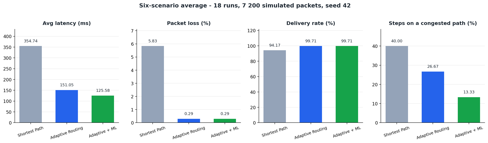

# Adaptive Routing Based on Real-Time Network Conditions

**Author:** Maddur Vignesh — [github.com/maddurvignesh](https://github.com/maddurvignesh)

A 3rd-year Computer Networks + Machine Learning project: a **network
simulation and adaptive routing decision system** that chooses paths from
*live* link conditions, optionally augmented by a supervised congestion
predictor, and measures the result against a load-oblivious baseline.

> **Scope:** everything runs inside one Python process. No packets leave the
> machine, no results are hard-coded, and no external dataset is downloaded.



## Headline result

Six scenarios × three strategies = 18 runs, 7 200 simulated packets, seed 42.

| Strategy | Avg latency (ms) | Packet loss (%) | Delivery (%) | Steps on a congested path (%) |
|---|---:|---:|---:|---:|
| Shortest Path (hop count) | 354.74 | 5.83 | 94.17 | 40.00 |
| Adaptive Routing | 151.05 | 0.29 | 99.71 | 26.67 |
| Adaptive + ML | **125.58** | **0.29** | **99.71** | **13.33** |

Against hop-count routing: **−57.4 %** latency, **−95.0 %** packet loss,
**+43 %** throughput. The ML penalty adds a further **−16.9 %** latency by
moving one step earlier in the scenario designed to isolate it.

Full tables and per-scenario analysis: [`docs/experiments.md`](docs/experiments.md).

## Quick start

```bash
pip install -r requirements.txt

python -m ml.dataset        # generate data/congestion_dataset.csv  (5 000 rows)
python -m ml.train          # train + save models/congestion_model.joblib
python -m pytest            # 281 tests
python docs/diagrams.py     # regenerate the figures in docs/
python docs/build_presentation.py   # regenerate the .pptx deck

streamlit run app.py        # the dashboard
```

The dashboard has six pages: **Overview**, **Network Topology**,
**Adaptive Routing**, **Network Simulation**, **ML Prediction** and
**Performance Comparison**. The last page runs the full 18-run matrix and
writes `results/*.csv`.

### Themes

The UI is styled entirely by injected CSS (`visualization/theme.py`): an
animated aurora background of drifting blurred orbs, a panning grid, a noise
overlay and glassmorphism cards with hover glow and gradient headings.

Pick a theme in the sidebar — **Aurora** (default), **Sunset**, **Arctic** or
**Minimal** (flat, no motion; useful on a projector). Pin one per deployment:

```powershell
$env:ARX_THEME="Arctic"
streamlit run app.py
```

The design honours `prefers-reduced-motion: reduce`, so the animation turns
itself off for users who ask for it.

To review the design visually:

```bash
streamlit run app.py                      # in one terminal
python docs/screenshot.py "ML Prediction" # in another
```

## How it works

```
cost(link) = 0.35 · min(latency/100ms, 1)
           + 0.30 · congestion
           + 0.25 · min(packet_loss/0.20, 1)
           + 0.10 · (1 − min(bandwidth/1000Mbps, 1))
           + ML penalty            (Normal 0.00 / Warning 0.35 / Congested 0.90)
```

Every term is normalised to `[0, 1]`, so Dijkstra over this weight returns the
minimum-cost path **under current conditions**. The ML module reaches the
router only through a plain callback — `penalty(u, v, attrs) -> float` — so
`core` never imports `ml` and the system still runs without the model file.

Packets are simulated per hop with transmission delay
(`size / bandwidth`), a non-linear queueing curve `k·c/(1−c)`, a drop
probability `1 − (1−loss)·reliability`, stop-and-wait retransmission and
seeded jitter.

## Layout

```
adaptive-routing/
├── app.py                 Streamlit entry point
├── config.py              every constant in one place
├── core/                  topology, conditions, routing, packet simulator
├── ml/                    dataset, shared definitions, training, prediction
├── simulation/            metrics, scenarios, experiments, engine facade
├── visualization/         dashboard pages, Plotly charts, topology figure, CSS theme
├── tests/                 281 unit + headless dashboard integration tests
├── data/  models/  results/   generated artefacts
└── docs/                  report, architecture, methodology, experiments, viva
```

## Documentation

| Document | Contents |
|---|---|
| [`docs/report.md`](docs/report.md) | the full project report (abstract → conclusion) |
| [`docs/architecture.md`](docs/architecture.md) | layers, module map, data flow, dependency rules |
| [`docs/methodology.md`](docs/methodology.md) | algorithms, formulas, dataset design, metrics |
| [`docs/experiments.md`](docs/experiments.md) | full result tables and analysis |
| [`docs/presentation.md`](docs/presentation.md) | slide-by-slide presentation content |
| [`docs/viva.md`](docs/viva.md) | anticipated examiner questions and answers |
| `docs/Adaptive_Routing_Presentation.pptx` | the ready-to-present 16-slide deck |

Figures (regenerate with `python docs/diagrams.py`): `architecture.png`,
`routing_decision.png`, `topology.png`, `results_summary.png`,
`ml_confusion.png`, `ml_importance.png`.

The deck is generated from code, so it never drifts from the results:

```bash
python docs/build_presentation.py                        # rebuild the .pptx
powershell -ExecutionPolicy Bypass -File docs\export_slides.ps1   # slide previews
```

Before printing, edit `STUDENT` and `GUIDE` at the top of
`docs/build_presentation.py` and rebuild.

## Requirements

Python 3.10+ (developed on 3.12) and the packages in `requirements.txt`:
NetworkX, pandas, NumPy, scikit-learn, joblib, Plotly, Matplotlib, Streamlit
and pytest.

## Author

**Maddur Vignesh** — [github.com/maddurvignesh](https://github.com/maddurvignesh)

This project is the author's own work: the network model, the packet
simulator, the routing algorithms, the ML pipeline, the dashboard, the
experiments and the documentation were all written for this submission. No
external dataset was downloaded and no results were copied — every number
reported here is regenerated by the code in this repository.

## Honesty notes

* The congestion dataset is **generated** by `ml/dataset.py`; its labels come
  from an explicit, documented formula. The reported 98.5 % accuracy therefore
  measures consistency with that formula, not real-world accuracy. The ML
  module's practical value is demonstrated end-to-end by experiment 5, where
  the prediction changes an actual routing decision.
* The ML penalty changes the outcome in **one of six** scenarios. That is
  reported rather than hidden.
* Results are deterministic (seed 42, one fixed topology) — reproducible, but
  not a statistical sample.
